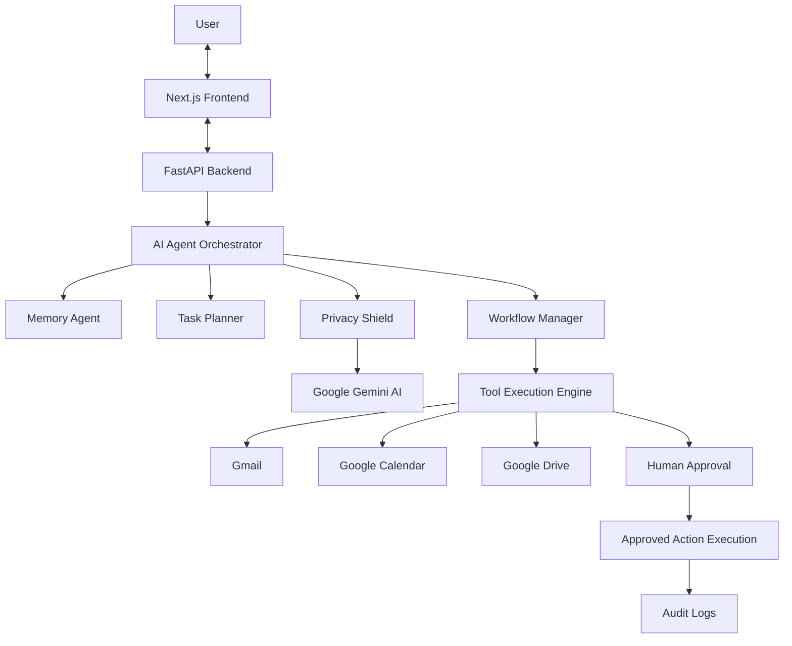

# 🤖 Personal AI Assistant

### Your AI-powered assistant to manage emails, meetings, files, and daily tasks from one place.

**One AI Assistant. Multiple Applications. Everything Simplified.**

---

## 📌 About the Project

Personal AI Assistant is an intelligent productivity application that helps students and professionals manage their daily activities using Artificial Intelligence.

Instead of opening multiple applications to manage emails, check meetings, and search for documents, users can perform these tasks through a single conversational interface.

Simply type what you want, and the AI assistant understands your request, creates an action plan, and performs the required tasks across connected Google applications.

The system currently supports:

- 📧 Gmail – Read emails and prepare email drafts.
- 📅 Google Calendar – Find meetings and manage schedules.
- 📁 Google Drive – Search and locate important documents.

The assistant uses Agentic AI to understand user instructions, divide complex requests into smaller tasks, and execute them in the correct order.

---

## ✨ Key Features

### 1. AI Chat Assistant
- Interact with the assistant using natural language.
- Understands simple instructions.
- Converts complex requests into smaller tasks.
- Provides responses based on task execution.

### 2. Gmail Integration
- Search and read emails.
- Find important email information.
- Prepare email drafts automatically.
- Identify meeting participants.

### 3. Google Calendar Integration
- Find upcoming meetings.
- Check schedules and events.
- Identify scheduling conflicts.
- Retrieve meeting participants.

### 4. Google Drive Integration
- Search for documents and files.
- Locate project reports and important documents.
- Retrieve relevant file information.

### 5. Smart Memory System
- Remembers important user preferences.
- Stores useful information for future tasks.
- Maintains contextual information.
- Helps the assistant provide personalized responses.

### 6. Human Approval System
- Sensitive actions require user permission.
- Users can review proposed actions before execution.
- Users can approve or reject actions.
- Prevents unwanted actions from being executed automatically.

### 7. AI Activity Monitoring
- Displays the steps performed by the AI.
- Shows task execution progress.
- Maintains activity history.
- Provides a transparent view of AI operations.

### 8. Additional Intelligence
- Daily Morning Briefing.
- Automatic Schedule Conflict Detection.
- Privacy Shield for sensitive information.
- Secure activity and audit logging.

---

## 🏗️ System Architecture

The application follows a modular architecture in which the frontend communicates with the backend, and the backend coordinates different AI agents and Google services.



### How It Works

1. The user enters a request through the chat interface.
2. The backend receives and processes the request.
3. The AI understands the user's intention.
4. The task planner divides complex requests into smaller steps.
5. Different agents communicate with Gmail, Calendar, and Drive.
6. The system requests approval before performing sensitive actions.
7. After approval, the requested action is executed.
8. The assistant displays the result and records the activity.

---

## 🛠️ Technology Stack

| Category | Technologies |
|---|---|
| Frontend | Next.js 15, React, TypeScript |
| Styling | Tailwind CSS |
| Backend | Python, FastAPI |
| AI Model | Google Gemini API |
| AI Framework | LangChain, LangGraph |
| Database | SQLite |
| Memory | Persistent Memory Service |
| Authentication | Google OAuth 2.0 |
| Integrations | Gmail API, Google Calendar API, Google Drive API |
| Testing | Pytest |
| Version Control | Git, GitHub |

---

## 📂 Project Structure

```text
Personal-AI-Assistant/
│
├── frontend/
│   ├── src/
│   ├── public/
│   ├── package.json
│   └── ...
│
├── backend/
│   ├── app/
│   ├── tests/
│   ├── requirements.txt
│   ├── .env
│   └── ...
│
├── docs/
│   ├── architecture.png
│   └── screenshots/
│
├── .gitignore
├── README.md
├── start.bat
└── Personal AI Assistant.code-workspace
```

*Note: This is the planned documentation structure. Existing project folders and files should retain their actual names.*

---

## ⚙️ Installation and Setup

Follow these steps to run the application on your computer.

### Prerequisites

Make sure you have installed:

- Python 3.11 or later.
- Node.js 18 or later.
- npm.
- Git.
- Visual Studio Code (recommended).

### Step 1: Clone the Repository

```bash
git clone https://github.com/Abhay-Site/Personalise-AI-Assistant-.git
```

Navigate to the project folder:

```bash
cd Personalise-AI-Assistant-
```

### Step 2: Setup Backend

Open a terminal:

```bash
cd backend
```

Create a Python virtual environment:

```bash
python -m venv venv
```

Activate the environment on Windows:

```powershell
.\venv\Scripts\activate
```

Install the required packages:

```bash
pip install -r requirements.txt
```

### Step 3: Configure Environment Variables

Create a `.env` file inside the backend folder.

Add the following configuration:

```env
GEMINI_API_KEY=your_gemini_api_key
GEMINI_MODEL=gemini-1.5-flash

GOOGLE_CLIENT_ID=your_google_client_id
GOOGLE_CLIENT_SECRET=your_google_client_secret

DATABASE_URL=sqlite:///./personal_ai_assistant.db

FRONTEND_URL=http://localhost:3000
```

Replace the placeholder values with your actual credentials.

The application also supports a demo mode when optional AI or Google credentials are not configured, as implemented in the backend.

**Important:** Never upload your `.env` file, API keys, OAuth credentials, or private tokens to GitHub.

### Step 4: Start Backend Server

Run:

```bash
uvicorn app.main:app --reload --port 8000
```

Backend URL:

`http://localhost:8000`

API Documentation:

`http://localhost:8000/docs`

### Step 5: Setup Frontend

Open another terminal:

```bash
cd frontend
```

Install dependencies:

```bash
npm install
```

Start the frontend:

```bash
npm run dev
```

Frontend URL:

`http://localhost:3000`

Your Personal AI Assistant is now ready to run locally!

---

## 🧪 Testing

The project includes 36 automated unit and integration tests covering different application components.

Run the test suite from the backend directory:

```bash
python -m pytest tests/ -v
```

### Testing Modules

| Test Module | Purpose |
|---|---|
| System Health | API health and server functionality |
| Database | Data storage and memory management |
| AI Chat | Request processing and AI responses |
| HITL Approval | Approval and rejection of sensitive actions |
| Google Integration | Gmail, Calendar, and Drive connectivity |
| Workflows | Multi-step task execution |
| Safety & Audit | Privacy protection and activity logging |
| Differentiation | Morning Briefing and Conflict Auditor |
| Master Demo | Complete application workflow |

---

## 💡 Example Use Case

Imagine you want to prepare for an upcoming project meeting.

Instead of manually checking your calendar, searching Google Drive, and composing an email, simply enter this instruction:

**Example Prompt:**

"Find tomorrow's project review meeting, locate the latest project report, and prepare an email for all participants."

### What the Assistant Does

1. **Finds the Meeting:** Checks Google Calendar for tomorrow's project review.
2. **Identifies Participants:** Retrieves the meeting participants' email addresses.
3. **Finds the Report:** Searches Google Drive for the latest project report.
4. **Prepares the Email:** Creates an email draft with the relevant report information.
5. **Requests Approval:** Displays the draft for user review.
6. **Executes the Action:** Sends the email only after the user approves it.

All these tasks are managed through one conversational interface.

---

## 🔐 Security and Privacy

Security is an important part of the application.

The system includes:

- Google OAuth 2.0 authentication.
- Human approval for sensitive operations.
- Privacy Shield for detecting and masking sensitive information.
- Secure environment variable management.
- Sanitized activity logs.
- User-controlled action execution.

---

## 🔮 Future Enhancements

Some planned improvements include:

- WhatsApp integration.
- Voice-based interaction.
- More third-party application integrations.
- Advanced long-term memory.
- Personalized AI recommendations.
- Mobile application support.
- Advanced task scheduling and automation.

---

## 👨‍💻 Developer

**Abhay Chondhe**

Artificial Intelligence and Machine Learning Engineering Student.

GitHub: Abhay-Site

Project: Personal AI Assistant

---

## ⭐ Support

If you find this project interesting, consider giving the repository a ⭐ on GitHub.

Your feedback and suggestions are always welcome!

---

**Built with Python, Next.js, Google Gemini, and Agentic AI.**